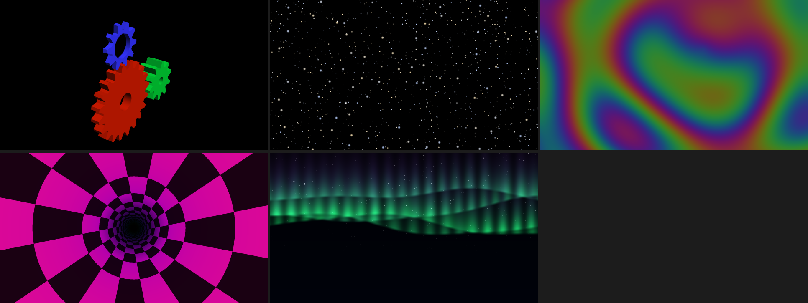
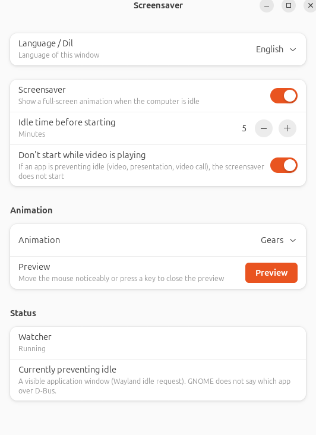

# gnome-idle-screensaver

[English](README.md) · [Türkçe](README.tr.md)

A screensaver for GNOME on Wayland. After the computer has been idle for a set time it shows a
full-screen animation, and closes on any key, click, scroll or deliberate mouse movement. It
**never locks** the session and does not touch GNOME's own blanking or lock settings.



GNOME 46 has no screensaver infrastructure, and XScreenSaver cannot see idle time on Wayland.
This program watches idle time through Mutter's `org.gnome.Mutter.IdleMonitor` D-Bus interface
instead, without polling.

## Features

- **Six animations**, each a small module: the three gears of glxgears (with anti-aliasing and a
  slowly orbiting camera), starfield, plasma, tunnel, aurora, and a plain black "screen off".
- **Respects video playback** and other idle inhibitors (switchable).
- **Settings window** (libadwaita) in English and Turkish; changes apply to the running watcher
  without a restart.
- **Cheap**: 0 % CPU while waiting; 3–6 % of one core while an animation runs, locked to 60 Hz
  ([measurements](docs/measurements.md)).
- **Nothing outside your home directory** when installed with `install.sh`.



## Install

Requires GNOME 46 or newer on Wayland (developed and tested on Ubuntu 24.04, GNOME 46, one
monitor, Intel graphics).

### From a release (Debian, Ubuntu)

Download the `.deb` from the [latest release](https://github.com/smlblr/gnome-idle-screensaver/releases/latest)
and install it:

```bash
sudo apt install ./gnome-idle-screensaver_*_amd64.deb
```

Log out and in once: the watcher starts with the session, and GNOME Shell usually shows a new
app icon only after that. Remove it with `sudo apt remove gnome-idle-screensaver`.

### From source

Needs Rust 1.92 or newer and the GTK 4 and libadwaita development files.

```bash
sudo apt install libgtk-4-dev libadwaita-1-dev
```

```bash
cargo build --release
./install.sh
```

`install.sh` writes only under `~/.local` and `~/.config`, needs no `sudo`, and starts the
watcher. `./uninstall.sh` removes everything it wrote (`--purge` also deletes your settings).
Do not use both this and the `.deb`: there would be two autostart entries.

| What | Where |
|---|---|
| Binary | `~/.local/bin/gnome-idle-screensaver` |
| App entry | `~/.local/share/applications/io.github.smlblr.GnomeIdleScreensaver.desktop` |
| Autostart | `~/.config/autostart/io.github.smlblr.GnomeIdleScreensaver.Daemon.desktop` |
| Icon | `~/.local/share/icons/hicolor/scalable/apps/io.github.smlblr.GnomeIdleScreensaver.svg` |
| Settings (created on first change) | `~/.config/gnome-idle-screensaver/config.toml` |

A release build takes a few minutes and uses every core by default; on a laptop, prefer
`nice -n 10 cargo build --release -j 4`.

## Settings

Open **Screensaver** from the app grid (or run `gnome-idle-screensaver settings`). Every change
is saved at once.

| Setting | `config.toml` key | Default |
|---|---|---|
| Language (auto, English, Türkçe) | `language` | `"auto"` |
| Screensaver on/off | `enabled` | `true` |
| Idle time in minutes (1–720) | `idle_minutes` | `5` |
| Don't start while video is playing | `respect_inhibitors` | `true` |
| Animation | `animation` | `"gears"` |

| `animation` | Shows | Options |
|---|---|---|
| `gears` | The three glxgears gears, anti-aliased, orbiting camera | `rotation_speed`, `camera_speed`, `colors`, `msaa_samples` |
| `starfield` | Flying through stars | `speed` |
| `plasma` | Dim, slow sine-wave colour flow | `speed` |
| `tunnel` | Checkered tunnel | `speed` |
| `aurora` | Northern lights over a starry sky | `speed` |
| `blank` | Plain black, looks like the display is off (the backlight stays on) | none |

The options have no window yet; put them in `config.toml`:

```toml
[animations.gears]
rotation_speed = 70.0   # degrees per second of the big gear (glxgears: 70)
camera_speed = 5.0      # degrees per second the camera orbits
msaa_samples = 4        # clamped to what the driver supports

[animations.plasma]
speed = 0.5
```

A broken table never leaves the screen black: it is logged and the defaults are used.

**Preview** shows the chosen animation right away. To look at one without changing anything:
`gnome-idle-screensaver preview --animation aurora --seconds 15`.

### Why doesn't it start on my machine?

The window's **Status** section lists what currently prevents idle. A visible app window
(a browser tab with video, for example) asks GNOME to prevent idle, and while it does the
screensaver does not start, by design. GNOME does not say which window it is, so the list can
only say "a visible application window", plus a guess if a media player is playing. Turn off
"Don't start while video is playing" to ignore it.

## Command line

```
gnome-idle-screensaver [settings|daemon|preview] [-v] [--seconds N] [--animation ID]
```

`-v` logs frame rate, focus and close latency. `GNOME_IDLE_SCREENSAVER_CONFIG=/path/config.toml`
uses another settings file. The watcher logs to the journal:
`journalctl --user -b | grep gnome-idle-screensaver`.

## Known limits

- Tested on one machine: single monitor, Intel graphics, Ubuntu 24.04. Multiple monitors open one
  window each but have not been tried. Reports from other setups are welcome.
- Only GNOME (Mutter). Other Wayland compositors do not offer the idle interface used here.
- `amd64` only for the `.deb`; the source has no such limit.

## Documentation

- [Architecture](docs/architecture.md): how it works, how to add an animation or a language, and
  the reasoning behind the design choices.
- [Measurements](docs/measurements.md): CPU, memory, frame rate and latency numbers.

## Contributing

Issues and pull requests are welcome. `CLAUDE.md` holds the working rules, including the comment
policy (comments say why, never what, at most three lines). `cargo fmt` and `cargo clippy` should
be clean, and `cargo test` must pass. Tests that need a display run through `tools/gui-tests.sh`.

## License

[MIT](LICENSE). `src/animations/gears.rs` is a port of glxgears.c from Mesa demos, Copyright
(C) 1999-2001 Brian Paul, also MIT ([LICENSES/MIT-mesa-demos.txt](LICENSES/MIT-mesa-demos.txt)).
