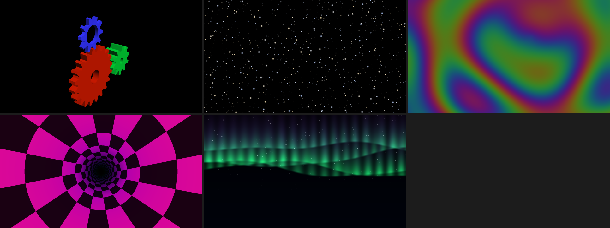
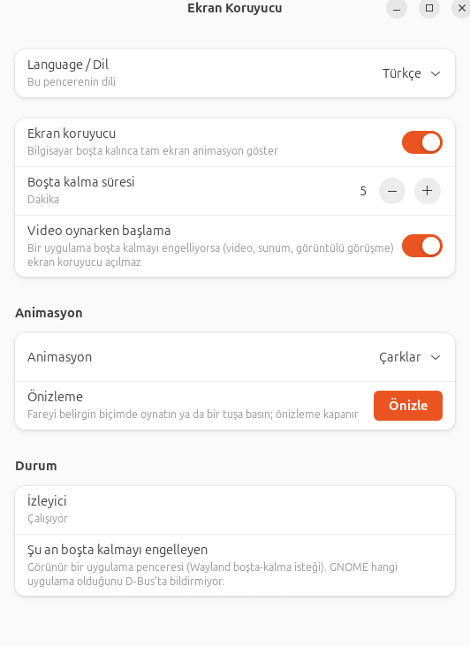

# gnome-idle-screensaver

[English](README.md) · [Türkçe](README.tr.md)

GNOME Wayland için ekran koruyucu. Bilgisayar ayarlanan süre boşta kalınca tam ekran bir animasyon
gösterir; bir tuş, tıklama, kaydırma ya da belirgin fare hareketiyle kapanır. Oturumu **asla
kilitlemez** ve GNOME'un kendi karartma/kilit ayarlarına dokunmaz.



GNOME 46'nın ekran koruyucu altyapısı yok, XScreenSaver de Wayland'de boşta kalma süresini göremez.
Bu program boşta kalmayı Mutter'ın `org.gnome.Mutter.IdleMonitor` D-Bus arayüzünden, anket
yapmadan izler.

## Özellikler

- **Altı animasyon**, her biri küçük bir modül: glxgears'ın üç çarkı (kenar yumuşatma ve yavaş
  dönen kamerayla), yıldızlar, plazma, tünel, kuzey ışıkları ve ekran kapanmış gibi düz siyah.
- **Video oynatımına ve diğer boşta-kalma engellerine saygı duyar** (kapatılabilir).
- **Ayarlar penceresi** (libadwaita) Türkçe ve İngilizce; değişiklikler çalışan izleyiciye
  yeniden başlatmadan yansır.
- **Hafif**: beklerken %0 CPU; animasyon sırasında bir çekirdeğin %3–6'sı, 60 Hz'e kilitli
  ([ölçümler](docs/measurements.md)).
- `install.sh` ile kurulunca **ev dizininiz dışında hiçbir yere yazmaz**.



## Kurulum

GNOME 46 veya üstü, Wayland gerekir (Ubuntu 24.04, GNOME 46, tek monitör, Intel ekran kartında
geliştirildi ve denendi).

### Sürümden (Debian, Ubuntu)

[Son sürümden](https://github.com/smlblr/gnome-idle-screensaver/releases/latest) `.deb` dosyasını
indirip kurun:

```bash
sudo apt install ./gnome-idle-screensaver_*_amd64.deb
```

Bir kez oturumu kapatıp açın: izleyici oturumla başlar, GNOME Shell de yeni uygulama simgesini
çoğu zaman ancak bundan sonra gösterir. Kaldırmak için `sudo apt remove gnome-idle-screensaver`.

### Kaynaktan

Rust 1.92 veya üstü ile GTK 4 ve libadwaita geliştirme dosyaları gerekir.

```bash
sudo apt install libgtk-4-dev libadwaita-1-dev
```

```bash
cargo build --release
./install.sh
```

`install.sh` yalnızca `~/.local` ve `~/.config` altına yazar, `sudo` istemez, izleyiciyi başlatır.
`./uninstall.sh` yazdığı her şeyi kaldırır (`--purge` ayarlarınızı da siler). Bunu ve `.deb`'i birlikte
kullanmayın: iki otomatik başlatma girdisi olur.

| Ne | Nereye |
|---|---|
| İkili | `~/.local/bin/gnome-idle-screensaver` |
| Uygulama girdisi | `~/.local/share/applications/io.github.smlblr.GnomeIdleScreensaver.desktop` |
| Otomatik başlatma | `~/.config/autostart/io.github.smlblr.GnomeIdleScreensaver.Daemon.desktop` |
| Simge | `~/.local/share/icons/hicolor/scalable/apps/io.github.smlblr.GnomeIdleScreensaver.svg` |
| Ayarlar (ilk değişiklikte oluşur) | `~/.config/gnome-idle-screensaver/config.toml` |

Sürüm derlemesi birkaç dakika sürer ve varsayılan olarak bütün çekirdekleri kullanır; dizüstünde
`nice -n 10 cargo build --release -j 4` tercih edin.

## Ayarlar

Uygulama ızgarasından **Ekran Koruyucu**'yu açın (ya da `gnome-idle-screensaver settings`). Her
değişiklik anında kaydedilir.

| Ayar | `config.toml` anahtarı | Varsayılan |
|---|---|---|
| Dil (otomatik, English, Türkçe) | `language` | `"auto"` |
| Ekran koruyucu açık/kapalı | `enabled` | `true` |
| Boşta kalma süresi (dakika, 1–720) | `idle_minutes` | `5` |
| Video oynarken başlama | `respect_inhibitors` | `true` |
| Animasyon | `animation` | `"gears"` |

| `animation` | Gösterdiği | Seçenekler |
|---|---|---|
| `gears` | glxgears'ın üç çarkı, kenarları yumuşatılmış, dönen kamera | `rotation_speed`, `camera_speed`, `colors`, `msaa_samples` |
| `starfield` | Yıldızların arasında uçuş | `speed` |
| `plasma` | Sönük ve yavaş sinüs dalgası renk akışı | `speed` |
| `tunnel` | Dama desenli tünel | `speed` |
| `aurora` | Yıldızlı gökte kuzey ışıkları | `speed` |
| `blank` | Düz siyah, ekran kapanmış gibi görünür (arka ışık yanık kalır) | yok |

Seçeneklerin henüz penceresi yok; `config.toml`'a yazın:

```toml
[animations.gears]
rotation_speed = 70.0   # büyük çarkın hızı, derece/sn (glxgears: 70)
camera_speed = 5.0      # kameranın dönüş hızı, derece/sn
msaa_samples = 4        # sürücünün desteklediği değere kırpılır

[animations.plasma]
speed = 0.5
```

Hatalı bir tablo ekranı asla siyah bırakmaz: günlüğe yazılır, varsayılanlar kullanılır.

**Önizle** seçili animasyonu hemen gösterir. Hiçbir şeyi değiştirmeden birine bakmak için:
`gnome-idle-screensaver preview --animation aurora --seconds 15`.

### Makinemde neden başlamıyor?

Pencerenin **Durum** bölümü, şu an boşta kalmayı neyin engellediğini listeler. Görünür bir
uygulama penceresi (örneğin videolu bir tarayıcı sekmesi) GNOME'dan boşta kalmayı engellemesini
ister; bu sürdükçe ekran koruyucu tasarım gereği başlamaz. GNOME hangi pencere olduğunu
bildirmez; liste bu yüzden yalnızca "görünür bir uygulama penceresi" diyebilir, medya çalan bir
oynatıcı varsa bir tahmin ekler. Yok saymak için "Video oynarken başlama"yı kapatın.

## Komut satırı

```
gnome-idle-screensaver [settings|daemon|preview] [-v] [--seconds N] [--animation ID]
```

`-v` kare hızını, odağı ve kapanma gecikmesini günlüğe yazar. `GNOME_IDLE_SCREENSAVER_CONFIG=/yol/config.toml`
başka bir ayar dosyası kullanır. İzleyici günlüğe yazar:
`journalctl --user -b | grep gnome-idle-screensaver`.

## Bilinen sınırlar

- Tek makinede denendi: tek monitör, Intel ekran kartı, Ubuntu 24.04. Çoklu monitörde her monitöre
  bir pencere açılır ama denenmedi. Başka kurulumlardan gelen bildirimler değerlidir.
- Yalnızca GNOME (Mutter). Diğer Wayland pencere yöneticileri burada kullanılan boşta arayüzünü sunmaz.
- `.deb` yalnızca `amd64`; kaynak kodun böyle bir sınırı yok.

## Belgeler

- [Mimari](docs/architecture.tr.md): nasıl çalışır, animasyon ya da dil nasıl eklenir, tasarım
  kararlarının gerekçesi.
- [Ölçümler](docs/measurements.md): CPU, bellek, kare hızı ve gecikme sayıları.

## Katkı

Sorunlar ve çekme istekleri hoş karşılanır. Çalışma kuralları (yorum politikası dahil: yorumlar neden
söyler, ne değil, en fazla üç satır) `CLAUDE.md`'dedir. `cargo fmt` ve `cargo clippy` temiz, `cargo
test` geçer olmalı. Ekran gerektiren testler `tools/gui-tests.sh` ile çalışır.

## Lisans

[MIT](LICENSE). `src/animations/gears.rs`, Mesa demos'taki glxgears.c'nin uyarlamasıdır; Copyright
(C) 1999-2001 Brian Paul, o da MIT ([LICENSES/MIT-mesa-demos.txt](LICENSES/MIT-mesa-demos.txt)).
